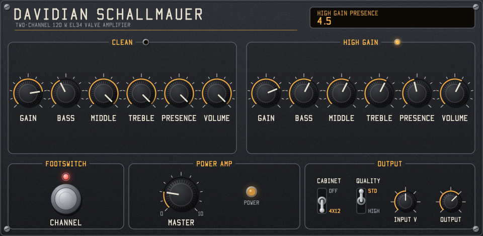

# Davidian Schallmauer

A circuit-modelled guitar amplifier plugin (LV2, VST3 and Audio Unit), modelled part by part on the schematic of a classic two-channel 120 W high-gain head with four EL34s: a clean channel and a high-gain channel switched by a relay and optos, a valve effects loop, a long-tailed-pair phase inverter, a push-pull EL34 power stage with its output transformer and global feedback, and a 16 Ω 4x12 speaker load. An optional cabinet curve follows the speaker.

**A close model, not an exact copy.** It is a simulation of the circuit from its component values, not a sampled or profiled amplifier. The schematic it follows has known errors, and some values are missing from it; the corrections and estimates are listed under [Corrections](#corrections-to-the-schematic) and [Estimates](#estimates). It has not been compared side by side with a real amplifier, so expect it to sound close to the hardware rather than identical.



Stereo in and out with no latency: the amplifier is mono, so the two inputs are averaged and both outputs carry the same signal. Every format is built from the same circuit code, shows the same GUI and sounds identical. GPL-3.0-or-later.

| Format | Windows | macOS | Linux |
|---|---|---|---|
| LV2 | yes | yes | yes |
| VST3 | yes | | yes |
| Audio Unit (AUv2) | | yes | |

## Download

Ready-made builds are on the [Releases page](https://github.com/evadavevadave/davidian-schallmauer/releases):

| Download | Contains | For |
|---|---|---|
| `…-windows-x64.zip` | LV2, VST3 | Windows 10/11, 64-bit hosts |
| `…-macos-universal.zip` | LV2, Audio Unit | macOS 10.13 or later, Apple silicon and Intel |
| `…-linux-x64.zip` | LV2, VST3 | 64-bit Intel/AMD Linux (glibc GLIBCVER or later, e.g. DISTROS; X11 or XWayland for the GUI) |
| `…-linux-arm64.zip` | LV2, VST3 | 64-bit ARM Linux, e.g. Raspberry Pi 4/5 with a 64-bit OS |

Unzip, copy the plugin folder for your host's format into its plugin folder, and restart your host (or rescan plugins):

| Format | Copy | Into |
|---|---|---|
| VST3 (Windows) | `Davidian Schallmauer.vst3` | `C:\Program Files\Common Files\VST3` |
| VST3 (Linux) | `Davidian Schallmauer.vst3` | `~/.vst3` (or `/usr/lib/vst3` for all users) |
| Audio Unit (macOS) | `Davidian Schallmauer.component` | `~/Library/Audio/Plug-Ins/Components` (or `/Library/Audio/Plug-Ins/Components` for all users) |
| LV2 (Windows) | `schallmauer.lv2` | `%APPDATA%\LV2` (create it if it doesn't exist) |
| LV2 (macOS) | `schallmauer.lv2` | `~/Library/Audio/Plug-Ins/LV2` |
| LV2 (Linux) | `schallmauer.lv2` | `~/.lv2` |

In the host it is listed as **Davidian Schallmauer** (VST3, LV2; under Distortion effects in VST3 hosts and as a simulator in LV2 hosts) or under **Davidian** as **Schallmauer** (Audio Unit; manufacturer code `Dvdn`, subtype `Shmr`). The LV2 URI is `urn:davidian:schallmauer`.

The macOS build isn't notarized, so macOS may block it after download. Run these once in Terminal after copying:

```bash
xattr -dr com.apple.quarantine ~/Library/Audio/Plug-Ins/Components/"Davidian Schallmauer.component"
```

```bash
xattr -dr com.apple.quarantine ~/Library/Audio/Plug-Ins/LV2/schallmauer.lv2
```

Logic Pro and GarageBand only show an Audio Unit once macOS has registered it. If it doesn't appear, log out and back in, or restart the Mac. In Logic, Plug-in Manager can rescan it, and `auval -v aufx Shmr Dvdn` in Terminal shows why it fails if it does.

## Controls

Defaults are the owner's manual's suggested starting settings, read as 0–10.

| Panel | Control | Circuit part |
|---|---|---|
| Clean | Gain | P7 (390k), default 8 |
| Clean | Bass, Middle, Treble | P8 (220k), P9 (22k), P10 (240k); defaults 4, 10, 10 |
| Clean | Presence | P11 (270k), in the clean tone stack; default 10 |
| Clean | Volume | P12 (430k), default 10 |
| High Gain | Gain | P1 (475k) with its bright caps, default 6 |
| High Gain | Bass, Middle, Treble | P2 (1M), P3 (25k), P4 (470k); default 6 |
| High Gain | Presence | P5 (2.2k), in the global feedback network; default 6 |
| High Gain | Volume | P6, after R70 (see [Corrections](#corrections-to-the-schematic)); default 6 |
| Footswitch | Channel | The channel relay and optos: Clean or High Gain (the default). The global feedback opto is lit on High Gain only, as on the schematic |
| Power Amp | Master | P13 (220k), default 2 |
| Power Amp | Power lamp | Glows with the power into the speaker; fully lit at 120 W |
| Output | Cabinet | Off, or a 4x12 cabinet curve after the speaker (the default) |
| Output | Quality | Standard (the default) or High: how far the circuit is oversampled (see [How it is modelled](#how-it-is-modelled)). Changing it restarts the circuit from its operating point. |
| Output | Input V | Volts at the input jack for a 0 dBFS sample (0.1 to 10, default 1.0) |
| Output | Output | Not on the amplifier: -24 to +12 dB, default 0 dB |
| (host) | Enabled | Plugin bypass with a 20 ms crossfade. In VST3 it is the host's bypass switch, and in an Audio Unit the host's bypass turns it off. The amplifier keeps running while bypassed, so it comes back without a thump. |

Gain, Volume, Master, Bass and Treble have an audio taper (10% at half rotation); Middle and Presence are linear. Channel changes fade over 30 ms, like the optos' LEDs, and the other knobs are smoothed over 15 ms.

With Cabinet off, the output is the voltage across the speaker: 30 V is 0 dBFS, so full power (about 62 V peaks into 16 Ω) peaks near +6 dBFS. Use Output to bring it down.

Drag a knob up or down, hold Shift to fine-tune, use the mouse wheel, and double-click to reset. Click the footswitch to change channel, and the upper or lower part of the Cabinet or Quality switch to pick that position. The readout shows the name and value of the last control you touched. In VST3 and Audio Unit hosts every move on the panel is a proper edit, so automation records it.

## How it is modelled

All with the schematic's part values, in `src/amp.c`, `src/tube.h` and `src/net.h`.

- **Passive networks** (`src/net.h`): each coupling, tone and load network between two valves is a small nodal-analysis circuit. Capacitors and inductors use the trapezoidal rule (backward Euler in the output transformer network, whose valves switch off abruptly). Each network is reduced to a Thévenin source at the valve it feeds, so the valve and its network are solved together.
- **Valves** (`src/tube.h`): 12AX7 triodes and EL34 pentodes with Koren's equations, tabulated for speed, and grid current from Dempwolf's diode law. Each valve's plate current is solved by Newton's method together with its grid current and its cathode. The EL34 screens move with their supply, and their current rises in the knee.
- **Preamp:** V1a input stage; on the high-gain channel V1b, V2b and V3a in cascade, then the V3b cathode follower into the tone stack; on the clean channel V4b into its own tone stack. The channel relay and the optos switch between them.
- **Effects loop and master:** the V5a send follower, the loop return (taken as a direct connection, with nothing in the loop), V5b and the master.
- **Power section:** a long-tailed-pair phase inverter, four EL34s in push-pull at their fixed bias, and the output transformer (primary inductance, leakage, winding capacitance and core loss). The inverter, the output valves and the global feedback loop are solved together within each sample, so the feedback has no one-sample delay.
- **Supplies:** the reservoir sags with the output valves' current through the rectifier and transformer resistance, and the screens draw from it through the choke.
- **Speaker load:** a 16 Ω 4x12 as voice-coil resistance and inductance with the box resonance (about 56 Ω at 105 Hz), so the power stage sees a real speaker rather than a resistor.
- **Oversampling:** with Quality on Standard the circuit runs at 2× the host rate up to 50 kHz and 1× above that; on High, at 4× up to 50 kHz, 2× up to 100 kHz and 1× above that. The filters are polyphase half-band filters (100 dB stopband). At 44.1 and 48 kHz the two settings measure within about 1 dB of each other in every third-octave band, on the test riffs at every setting tried.
- **Sleep:** once the speaker has stayed below -100 dBFS for half a second with the controls still, the circuit stops running until the input rises or a control moves, and then carries on from where it stopped. With a guitar plugged in, an interface's noise floor is enough to keep it awake at high gain, as it would be audible hiss.
- **Cabinet:** seven biquads shaping a closed-back 4x12 with 12" drivers: low-end roll-off and thump, a midrange dip, a presence peak near 2.6 kHz, and a steep top-end roll-off.

CPU use at 48 kHz on a current x64 desktop, as a share of one core (from `golden bench`, see [Tests](#tests)):

| | Standard | High |
|---|---|---|
| Silence (after half a second) | about 0% | about 0% |
| -90 dBFS noise floor, high-gain defaults | 22% | 39% |
| Playing, high-gain defaults | 20% | 36% |
| Playing, clean defaults | 13% | 23% |
| Playing, high gain with every control up | 61% | 65% |

### Checked against the schematic and published specs

| Item | Model | Source |
|---|---|---|
| Output valves | 4 × EL34, push-pull | Schematic |
| Idle current per EL34 | 25 mA, bias -47 V | Owner's manual: 25 mA |
| Power at the onset of clipping (gain 1 dB down) | 136 W into 16 Ω | Owner's manual: 120 W |
| Flat out (square wave) | 202 W, the supply sagging from 475 V to 441 V | |
| Preamp plates at idle | 173–258 V | Typical for 12AX7 stages on these supply rails |
| Phase inverter at idle | 2.0 and 1.8 mA, cathodes at 58 V | Long-tailed-pair design references |

### Corrections to the schematic

The schematic is marked as possibly containing errors, and a few parts can't be right as drawn:

- **R15** (V2b plate load) reads 1k, which would leave that stage with almost no gain. Every other plate load is 100k or more, so it is taken as 100k.
- **High-gain volume and tone stack:** R70 is drawn from the treble pot's wiper back to the pot's own end, the volume pot P6 hangs off the middle pot's wiper, and nothing in the stack is grounded. A published hot-rodded British amp with the same treble-middle-bass stack takes its output from the treble wiper through a series resistor into a 1M volume pot. The model wires R70 (270k) the same way, into P6 to ground, and grounds the middle pot's far end. P6 reads 10k, but behind 270k that would cap the channel at under 2 W with every knob up. It is taken as 1M, which puts the channel a few dB above the clean channel and reaches full power near the top of the Master.

### Estimates

These values are not on the schematic, so they are reasoned estimates:

- **Missing capacitor values:** C4 22 nF (clean middle, no value given), C310 1 nF (clean presence, "???"), C9 22 nF (feedback network, "??") and C136 100 pF (across R126, no value given).
- **Power supply:** 475 V idle B+, 40 Ω rectifier and transformer resistance, 470 µF reservoir, a 100 Ω choke into a 50 µF screen supply, 1k screen resistors, 15 mA drawn by the preamp and phase inverter.
- **Output transformer:** 1.7k plate to plate into the 16 Ω tap, 25 H primary inductance, leakage corner 25 kHz, 0.5 nF winding capacitance at the primary, core loss as 2k across the secondary.
- **Optos:** 2k lit and 20 MΩ dark.
- **Valve capacitances:** Miller capacitance from each stage's gain and the 12AX7's grid-to-plate capacitance.
- **Speaker:** voice coil 11.5 Ω and 1.5 mH, box resonance 105 Hz.

### Simplifications

- The effects loop is a direct connection, as with nothing plugged into it.
- Valve heaters, hum and noise are not modelled.
- All valves of a type are identical, and the EL34s are perfectly matched.
- The preamp supply rails are fixed at their idle values; only the power valves' supply and screens sag.

## Build

The LV2 build is plain C11 (the macOS window layer is compiled as Objective-C) and needs no LV2 SDK or other libraries. The VST3 and the Audio Unit need their SDKs, which CMake downloads while configuring: the Steinberg VST3 SDK 3.8.1 (MIT) and Apple's AudioUnitSDK 1.2.0 (Apache 2.0).

| Source | What it is |
|---|---|
| `src/amp.c`, `src/amp.h` | The circuit: component values, networks, the per-sample solve and the DC operating point |
| `src/tube.h`, `src/net.h` | Valve models and their solvers; the passive network solver |
| `src/oversample.h`, `src/cab.h` | Half-band oversampling filters; the cabinet curve |
| `src/engine.c`, `src/engine.h` | Controls, oversampling and the per-sample loop, behind a small C API that every format uses |
| `src/params.h`, `src/ports.h` | Parameter names, ranges and text for VST3 and Audio Units, and the LV2 port numbers they match |
| `src/plugin.c`, `src/ui/ui_lv2.c` | LV2 plugin and GUI |
| `src/vst3/` | VST3 processor, controller and editor, and its CMake build |
| `src/au/` | Audio Unit, its Cocoa view and its Info.plist |
| `src/ui/panel.h`, `src/ui/view.c` | The panel and the window layer under it (Win32, Cocoa, X11), shared by every GUI |
| `src/ui/canvas.h`, `src/ui/font.h`, `src/ui/style.h` | Davidian GUI house style: software renderer, stroke font and palette |
| `src/lv2_abi.h` | The LV2 C interface, so no SDK is needed |
| `bundle/` | LV2 metadata |
| `licenses/` | The VST3 SDK and AudioUnitSDK licences, shipped inside the bundles that use them |

### Windows (Visual Studio)

Needs Visual Studio 2017 or later with the C++ tools. `build.bat` builds the LV2 bundle, `build\schallmauer.lv2`, and the Windows-only LV2 checks, without CMake.

```bash
build.bat
```

### Every platform (CMake)

Needs CMake 3.25 or later and a C/C++ compiler. On macOS, the Xcode command-line tools; add `-DCMAKE_OSX_ARCHITECTURES="arm64;x86_64"` for a universal build. On Linux, gcc or clang plus the X11 headers (`libx11-dev` on Debian/Ubuntu) for the GUI and the VST3; without them CMake builds the LV2 plugin alone, with no GUI.

```bash
cmake -S . -B build-cmake -DCMAKE_BUILD_TYPE=Release
```

```bash
cmake --build build-cmake --config Release
```

The VST3 lands in `build-cmake/VST3/Release` (Windows and Linux) and the Audio Unit in `build-cmake/AU` (macOS, signed ad hoc). The VST3 is on by default on Windows and Linux, and the Audio Unit on macOS; turn them off with `-DSCHALLMAUER_VST3=OFF` or `-DSCHALLMAUER_AU=OFF`, for example to build offline. `-DSCHALLMAUER_VST3=ON` also builds a VST3 on macOS, untested.

To copy the LV2 bundle into `~/.lv2` (Linux):

```bash
cmake --install build-cmake --prefix ~/.lv2 -DLV2_INSTALL_DIR=.
```

Without `-DLV2_INSTALL_DIR=.`, `cmake --install` puts it in `<prefix>/lib/lv2`.

## Tests

Windows, with `build.bat`:

```bash
build-test\test_dsp.exe build\schallmauer.lv2
```

```bash
build-test\lilv_check.exe build
```

```bash
build-test\ui_check.exe build\schallmauer.lv2
```

Every platform, with CMake:

```bash
ctest --test-dir build-cmake -C Release
```

- `test_dsp` checks the network solver against exact RC and LC responses, the valve tables against Koren's equations, the oversampling filters, the operating points of every valve, the direction and size of every tone control, the output power, stability with every control up and a 2 V input, channel switching while playing, and the built LV2 library at every common sample rate.
- `golden` is a sound regression check and benchmark, not run by `ctest` because it needs a reference. `golden render ref.bin` renders a set of riffs, sweeps, channel switches and control moves at 48 kHz (add `high` for the High quality setting); render again after a change and `golden compare ref.bin new.bin` reports, per scenario, the waveform error, its worst 20 ms, the level change and the largest change in any third-octave band. `golden bench` times each scenario.
- `ui_render` draws the panel to a BMP file without opening a window, on any platform: `build-test\ui_render.exe out.bmp`.
- `ui_check` (Windows) hosts the built GUI and drives it with mouse messages.
- `lilv_check` (Windows) validates the bundle with the lilv LV2 parser, without installing anything.
- `params_check` checks the VST3 and Audio Unit parameters against the LV2 ports and the panel.
- `vst3_check` (Windows and Linux) hosts the VST3, clicks and drags on its editor and checks the edits it reports, then compares its sound with the LV2 build. On Linux the editor checks need an X display (CI uses Xvfb: `xvfb-run -a ctest --test-dir build-cmake`) and are skipped without one. The VST3 build also runs Steinberg's validator.
- `au_check` (macOS) loads the Audio Unit from its bundle, compares its sound with the LV2 build, and opens its view. CI also runs Apple's `auval` on it.

Both sound comparisons cover parameter changes and the host's bypass, and expect the output to match the LV2 build exactly.

GitHub Actions builds and tests all four platforms from the same source on every push (see `.github/workflows/build.yml`), and publishes a release when a version is tagged.

## Use of AI

Made with generative AI (Claude Code), directed and reviewed by Davidian. See [AI_USAGE.md](AI_USAGE.md) for what the author and the AI each did, and what has and hasn't been checked.

## References

- [Owner's manual of the original amplifier (jam.ua)](https://m.jam.ua/files/files/UBERSCHALL%20TWIN%20JET%20MANUAL%202012.pdf): output power, bias current, suggested settings.
- [Discussion of the original's circuit for a commercial amp model (Fractal Audio forum)](https://forum.fractalaudio.com/threads/fractal-audio-amp-models-euro-uber-bogner-uberschall.113311/): the high-gain tone stack as a standard treble-middle-bass stack.
- [Schematic of a hot-rodded British-style amp with the same tone stack (Music Electronics Forum)](https://music-electronics-forum.com/forum/schematic-requests/1013225-friedman): the wiring of the high-gain volume after the stack.
- [The long-tailed pair phase inverter (Aiken Amplification)](https://aikenamps.com/index.php/the-long-tail-pair) and [long-tailed pair calculator (ampbooks)](https://ampbooks.com/mobile/amplifier-calculators/long-tailed-pair/): the phase inverter's operating point and feedback injection.
- Norman Koren, "Improved VT models for SPICE simulations" (1996), and Kristjan Dempwolf and Udo Zölzer, "A physically-motivated triode model for circuit simulations" (DAFx-11): the valve and grid-current equations.

## Licence

GPL-3.0-or-later. See [LICENSE](LICENSE), [NOTICE.md](NOTICE.md) and [AI_USAGE.md](AI_USAGE.md). Every source file carries an `SPDX-License-Identifier` line. `src/lv2_abi.h` is under the ISC licence, which is GPL-compatible, because it reproduces the LV2 interface declarations. The VST3 plugin includes code from the Steinberg VST3 SDK (MIT) and the Audio Unit from Apple's AudioUnitSDK (Apache 2.0), both GPL-3.0-compatible. The build copies `LICENSE`, `NOTICE.md` and `AI_USAGE.md` into every bundle. VST is a registered trademark of Steinberg Media Technologies GmbH.
